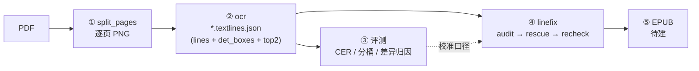

# pdf2epub

把**扫描 / 排版 PDF** 变成**可信文本**，最终产出 EPUB。

当前完成前四环，全部在《围城》368 页真实书上跑通并逐页对账：
**拆页 → OCR → 准确率评测 → 纠错层**。第五环（EPUB 组装）尚未开始。

纯 CPU、离线、可断点续跑；不依赖任何云服务。

---

## 当前状态

| 环节 | 实现 | 状态 | 实测 |
|---|---|---|---|
| ① 拆页 | `pipeline/split_pages.py` | ✅ | 368 页 / 300dpi / 56MB，47s |
| ② OCR | `pipeline/ocr.py` | ✅ | 368/368 页有产物，约 8.6~9.5s/页 |
| ③ 评测 | `scripts/ocr_accuracy_report.py` | ✅ | 正文页 **99.500%**（汉字 **99.857%**） |
| ④ 纠错层 | `linefix/{audit,rescue,recheck}.py` | ✅ | 全书漏行差异 **0** |
| ⑤ EPUB | —— | ❌ 未开始 | —— |



---

## 技术栈

- **Python 3.13**（本项目用 3.13.15 验证）
- **rapidocr 3.9.2** + **OpenVINO** 后端 + **PP-OCRv6 medium**（det / rec 均 medium，禁用方向分类）
- pymupdf（PDF 渲染）、OpenCV、NumPy、Pillow、jiwer / rapidfuzz（评测）
- 全部版本在 `requirements.txt` 里锁死；**换版本必须重跑回归**

---

## 快速开始

```bash
# 1) 环境（Windows）
python -m venv .venv
.venv/Scripts/python.exe -m pip install -r requirements.txt

# 2) 自检（34 项：权重位置、后端、字体、配置基线）
.venv/Scripts/python.exe scripts/check_rapidocr_env.py

# 3) 拆页：PDF → <pdf 同目录>/pages/page_NNN.png + split_manifest.json
.venv/Scripts/python.exe -m pipeline.split_pages --pdf orign_pdf/围城.pdf

# 4) OCR：→ <pages>/../textlines/*.textlines.json + ocr_manifest.json
.venv/Scripts/python.exe -m pipeline.ocr --pages orign_pdf/pages --max-minutes 9

# 5) 评测：→ docs/ocr-accuracy-围城.md
.venv/Scripts/python.exe scripts/ocr_accuracy_report.py

# 6) 纠错层（零推理审计 → 行级救援 → 字级复核）
.venv/Scripts/python.exe -m linefix.audit  --pages orign_pdf/pages --products orign_pdf/textlines
.venv/Scripts/python.exe -m linefix.rescue --pages orign_pdf/pages --products orign_pdf/textlines
.venv/Scripts/python.exe -m linefix.recheck --pages orign_pdf/pages --products orign_pdf/textlines
```

三条必须先知道的运行约束：

1. **禁止安装 `onnxruntime`** —— 保持「未安装」状态，才能证明推理确实走 OpenVINO
   （装了就有静默回退空间，配置里写 openvino 也可能实际跑在 onnxruntime 上）。
2. **单次后台调用别超过 ~10 分钟**（会被静默回收）→ OCR 用 `--max-minutes 9` 分批续跑，
   再跑同一条命令即自动接着干。
3. **两侧都可断点续跑**：跳过一页的前提是「manifest 有记录 ∧ 身份一致 ∧ PNG 头尺寸自洽」，
   「PNG 存在」本身不是跳过理由。

---

## 产物格式（`*.textlines.json`）

```json
{
  "page": "page_099",
  "line_count": 25,
  "provenance": {
    "backend": "openvino", "det_boxes_source": "raw", "audit_capable": true,
    "product_schema": 6, "top2_floor": 0.001, "alignment": "det_index",
    "top2_error": null, "drop_selfcheck": "ok"
  },
  "lines": [
    {"line_id": 1, "orig_line_id": 1, "added": false, "det_index": 0,
     "bbox": [x, y, w, h], "text": "我们自己…", "confidence": 0.998,
     "role": "text", "top2": [[9, 57, 0.9491, ",", 0.0509]]}
  ],
  "det_boxes": [[x, y, w, h]],
  "dropped_lines": [{"det_index": 3, "bbox": [], "text": "", "score": 0.0,
                     "reason": "empty_text"}]
}
```

五条口径（下游取数据只认这些）：

- `det_boxes` 是 **过滤前** 的原始检测框（不是 `result.boxes`，那个与文本永远 1:1，会让审计恒为 0）。
- **`det_index` 是证据归属的唯一依据**：`det_boxes[k]` ↔ `lines[].det_index == k`。
- `role`：`"text"` / `"page_number"`。页码行**只打标记、不删除**，下游按 `role != "page_number"` 取正文。
- `top2`：`[i, t, p1, c2, p2]` = 字符下标 / CTC 时间步 / top1 概率 / 第二候选字 / 第二候选概率。
  **只记 `p2/p1 ≥ top2_floor` 的位置**，所以数组**不与 `text` 逐字对齐** —— 定位一律用 `i`，别看数组下标。
- `dropped_lines`：`null` = 本次没采集；`[]` = 采集了、确实没丢。**两者语义不同，不能混**。

---

## 评测结果（《围城》368 页）

| 桶 | 页数 | 说明 |
|---|---|---|
| **正文页** | **313** | 主口径 |
| 脚注页 | 46 | 对照文本的脚注编码与书上不同，整桶排除 |
| 前置 / 后置页 | 5 | 版次不同 |
| 锚定失败 | 4 | 封面 / 插页 |

| 口径（正文页） | CER | 准确率 |
|---|---|---|
| N1（含页码行） | 0.891% | 99.109% |
| **N1（剔页码行）** | **0.500%** | **99.500%** |
| N2（NFKC + 剔页码） | 0.438% | 99.562% |
| **汉字-only** | **0.143%** | **99.857%** |

逐页：中位 0.286% / 90 分位 1.094% / 最差 2.455%，**无页 > 3%**。
差异归因见 `docs/ocr-accuracy-围城.md`：**整段删除占 60.9%，其中破折号 `—` 472 处**（CTC 结构性塌缩，见「已知缺陷」）。

---

## 回归

```bash
.venv/Scripts/python.exe scripts/check_rapidocr_env.py        # 环境 34 项
.venv/Scripts/python.exe tests/test_common_review.py          # 共用层 73 项
.venv/Scripts/python.exe tests/test_split_pages_matrix.py     # 拆页 83 项
.venv/Scripts/python.exe tests/test_ocr_review.py             # OCR 98 项
.venv/Scripts/python.exe tests/test_linefix_review.py         # 纠错层 79 项（含真实引擎闭环）
```

合计 **333 项**，测试数据落 `.tmp/`（已 gitignore）。

---

## 目录

```
pipeline/    拆页、OCR（产线前两环）
linefix/     common（共用实现层）+ audit / rescue / recheck（纠错层）
eval/        形近字裁判 score_glyph、人工复核贴图 review_sheet、冻结台账
scripts/     环境自检、准确率报告、一次性迁移脚本
tests/       四份回归（已入库）
docs/        HANDOFF.md（交接入口）、纠错层设计、评测报告
configs/     rapidocr 完整配置（OpenVINO + PP-OCRv6 medium）
orign_pdf/   源书与产物（pages/ textlines/ 不入库）
```

---

## 已知缺陷与路线图

| 优先级 | 问题 | 规模 | 方向 |
|---|---|---|---|
| **P1** | 破折号 `——` 塌缩成 `—` | 394 组被吞 | 规范化规则 / CTC 列宽证据 / 换 decoder |
| P2 | 引号 `‘ ’ ”` 丢失（`“` 反而无损） | 164 处 | det 框外扩 + 首末行 padding 二次识别 |
| P3 | 评测覆盖率 85%（脚注页整桶排除） | 46 页 | 元素级评测 |
| P4 | 汉字形近字 | 182 处 | 需《围城》自己的冻结台账（工具已就位） |

通用纠错模型路线**已证伪**：MacBERT4CSC 在本项目改对 10 / 误改 ~670（净损 −660）。

---

## 文档

| 文件 | 看它做什么 |
|---|---|
| `docs/HANDOFF.md` | **接手第一份**：现状 / 待决策 / 坑点速查 / 文件地图 |
| `docs/ocr-correction-design.md` | 纠错层设计基线：口径、阈值、运行手册、移植差异 |
| `docs/ocr-accuracy-围城.md` | 现行评测报告（分桶、逐页、差异归因） |

---

## 版权说明

本仓库为**私有**仓库：`orign_pdf/` 下的源 PDF 与对照文本是受版权保护的作品，
不作为代码分发。要公开本仓库，请先把这些文件移出版本库。
