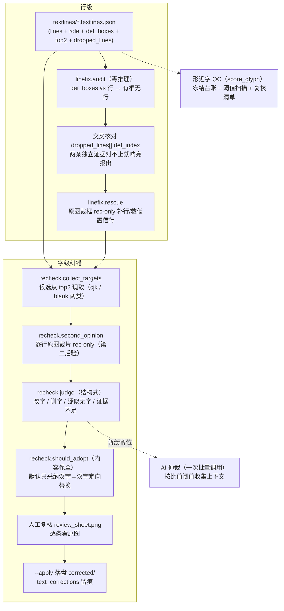

# OCR 纠错层设计（本项目 v2 · 2026-10-20）

> 范围：从「OCR 产物」到「可信文本」之间的**纠错子系统**。
> 不含：版面判断、结构组装、EPUB 打包（下游待建）。
> 本文是设计基线 —— 实现以代码为准，两者不一致时**先修文档**（本项目头号失败模式）。
>
> 移植来源：`D:\App\pdf_to_epub`（参考项目）的 `linefix/{audit,rescue,recheck}.py`
> 与 `eval/{score_glyph,review_sheet}.py`。移植时按本项目 `PRODUCT_SCHEMA 6`
> 重做了与产物口径相关的几处（见 §9「与参考实现的差异」）。

---

## 0. 设计原则（已定，不再讨论）

1. **判定 ≠ 采纳**：证据判据（`judge`）只给结论；写不写盘由采纳策略（`should_adopt`）决定。两处分开，改策略只动一处。
2. **提升小的不用**：标点全角半角（实测那 507 条摇摆）、装饰噪点、空白多寡 —— 影响面小却要动原文。
3. **对原文内容有损害的不用**：**任何删除都不采纳**（删字 = 不可逆地丢内容）。
4. **证据分层**：图像后验（采信）＞ 字形先验（不做）＞ 文本语义先验（AI，暂缓留位）＞ 模型训练（不做）。
5. **每个结论指得出来源**：异常落成计数（`common.inc`），进 provenance 与汇总，不许只 `print`。
6. **响亮失败优于静默降级**：缺字段/对不齐/长度变了 → 拒绝并计数，不硬凑。
7. **AI 的用法**：按阈值收集上下文，**打包成一次调用**批量仲裁，只判不改、判定不直接采纳。
8. **口径只写一份**：判据一律走 `linefix.common`，不在各阶段各抄一份。

---

## 1. 数据流



**执行顺序必须是 行级 → 字级**：`rescue` 会改写行文本（并使该行 `top2` 失效），
若先做字级再补行，字级判定的"两路一致"就是基于未修齐的行算的。

---

## 2. 各环节口径

| # | 环节 | 输入 | 输出 | 判据 / 参数 | 状态 |
|---|---|---|---|---|---|
| 1 | 行级漏行审计 | 产物 `det_boxes` | `<out>/audit/summary.json` + 逐页 `detrev/*.json` | 中心包含 + IoU≥0.30；最小尺寸按页归一化 | ✅ |
| 1b | 交叉核对 | `dropped_lines[].det_index` | summary 的 `dropped_*` 计数 | 只比**过了尺寸门槛**的丢弃行（碎片本就该忽略） | ✅ |
| 2 | 行级救援 | 差异框（W1）/ conf<0.75 行（W2） | `rescue/corrected/*` | 裁框、rec-only、验收 conf≥0.85 | ✅ |
| 3 | 候选收集 | 产物 `top2` / `alt_candidates` | 候选位列表（page/line/pos/kind/ratio） | 两类：`cjk`（第二候选也是汉字）/ `blank`（第二候选是空白）；`--ratio-min` | ✅ |
| 4 | 原图二次后验 | 行 bbox + 原图 | 第二文本 + conf + `word_cols` | rec_only、`use_preprocess_img=False`、pad=6 | ✅ |
| 5 | 字级定位 | `word_cols` + 行 bbox | 逐字 x 区间 | **端点标定**（不是均分、不是库绝对口径） | ✅ |
| 6 | 结构式判定 | 旧文本 vs 第二文本 | 改字/删字/疑无字/待核 | 长度不变 + 单点差异；长度 n−1 且缺目标位 | ✅ |
| 7 | 采纳策略 | verdict + kind | 是否写盘 | 默认 `--adopt cjk`：只采纳汉字定向替换 | ✅ |
| 8 | 人工复核 | 采纳清单 | 每条 真错/误改 | `eval/review_sheet.py` → 对照贴图 | ✅ 工具就绪 |
| 9 | 落盘 | 采纳条目 | `corrected/*.json` | `text_corrections` 留痕 + `PRODUCT_SCHEMA` 跟上 | ✅ |
| 10 | AI 仲裁 | 候选位上下文 | 每条 A/B/neither | **一次批量调用**；判定不直接采纳 | ⏸ 暂缓 |

---

## 3. 阈值体系（所有数值只有这一份清单）

| 阈值 | 值 | 用途 | 备注 |
|---|---|---|---|
| `TOP2_FLOOR` | `1e-3` | **采集**下限（进 provenance） | 必须严格低于任何评估阈值，否则扫描是同义反复 |
| 产线评估阈值 | `0.05` | top1=错字 & top2=对字 & p对/p错>thr | **单向**；反向规则会把合法的「自己」改成「自已」 |
| `--ratio-min` | `0` | recheck 候选过滤 | 想收紧再调 |
| `INK_CUT` | `0.25` | blank 类墨量比（相对本行中位字位） | **先验值**，必须按书重标（跑完看报告里的 `ink_quantiles_by_kind`） |
| `INK_GRAY_CUT` | `40` | 灰度差小于它的算白纸 | 去扫描底噪 |
| rec 验收 | conf≥0.85 | rescue 行级验收 | **只对行级**；字级靠结构式判据（conf 分不出对错：实测错字 conf 也在 0.97~0.999） |
| AI 收集阈值（暂缓） | 待定 | 只收 `改字`+`待核`，按比值升序 | **一次调用**，与条数无关 |

---

## 4. AI 仲裁留位（暂不实现，接口先定死）

- **触发**：人工复核预算不够时（台账外条数 > 20）。
- **输入（一次调用）**：候选位列表
  `[{id, 上下文±20字, 候选A=产物现状, 候选B=二次后验建议}, ...]`
- **输出（JSON 数组）**：`[{id, choice: "A"|"B"|"neither", reason}]` —— **没有改写权**。
- **标定**：先用本书冻结台账测准确率，达标才升为仲裁器；否则只用于排复核优先级。
- **红线**：结果只进 `adopt_why` 与复核清单，**不直接写盘**；删除类不问 AI。

---

## 5. 验收闸门（纠错层怎么算"好"）

1. **冻结台账**：`eval/glyph_confusion_set.json` 格式，逐条 `token/occ/off` 锚定 → 净收益 ≥ 0。
2. **交叉验证**：台账内条目与独立标定（原图二次后验）方向一致或明确冲突（冲突必须报出、不猜）。
3. **净收益 = 改对 − 待复核 ≥ 0**（`blind_swap` −1483、MacBERT4CSC −660 是反例基线）。
4. **零连带**：每处改动只动目标位。
5. **闭环**：`audit` 报差异 → `rescue` 补回 → 再 `audit` 归 0（`tests/test_linefix_review.py` ⑧ 节）。
6. **自检**：`tests/test_linefix_review.py`（79 项）+ 其余三份回归全绿。

---

## 6. 明确不做（负空间，防止返工）

- ❌ 删除类：删字、疑似无字、多余空格、装饰噪点
- ❌ 标点全角半角归一（507 条摇摆，影响小且属排版层）
- ❌ 字形先验（字形相似度 / IDS / 形状编辑距离）—— 独体字无结构、方向判不了、正确字 100% 已在 top2
- ❌ 开放式 AI 校对 / 通用 CSC 模型（MacBERT4CSC 已在本项目被证伪：改对 10 / 误改 ~670，净损 −660）
- ❌ 模型训练 / 换代际 / 混淆集微调（最重，需要标注）

---

## 7. 运行手册（一本书的纠错流程）

```bash
# 0) 前置：OCR 产物（必须带 det_boxes / top2，见 pipeline/ocr.py）
.venv/Scripts/python.exe -m pipeline.ocr --pages orign_pdf/pages --max-minutes 9

# 1) 行级：漏行审计（零推理，全书秒级）
.venv/Scripts/python.exe -m linefix.audit --pages orign_pdf/pages --products orign_pdf/textlines

# 2) 行级：救援（只补 audit 报出的差异框 + conf<0.75 的行）
.venv/Scripts/python.exe -m linefix.rescue --pages orign_pdf/pages --products orign_pdf/textlines

# 3) 字级：二次后验（默认只出报告，不动产物）
.venv/Scripts/python.exe -m linefix.recheck --pages orign_pdf/pages --products orign_pdf/textlines

# 4) 人工复核：先看报告里的采纳清单，再出对照贴图逐条看原图
.venv/Scripts/python.exe eval/review_sheet.py --pages orign_pdf/pages \
    --review orign_pdf/review_book.json --out .tmp/recheck_sheet.png

# 5) 落盘（只写被改动的页，源产物一律不动）
.venv/Scripts/python.exe -m linefix.recheck --pages orign_pdf/pages \
    --products orign_pdf/textlines --apply
```

⚠️ `recheck` 的候选位数量与书的排版强相关（《围城》368 页初扫 11488 个位、需重识别上千行），
先 `--limit 40` 抽样看口径，再决定全量；单次后台调用别超过 ~10 分钟。

---

## 8. 换书要做什么（冻结台账怎么建）

`score_glyph.py` 的台账**按书锚定**：`{page, token, occ, off, wrong, right, char_index,
ref_line_text, ref_bbox}`。异书台账会被**硬闸门拒绝（exit 2）**，不会打一张 0/34 的空表。

建一份新台账的顺序（**不要跳步**）：

1. `score_glyph --scan-thr 0.05` 扫全书 → `review_book.json/md`（台账外候选清单）。
2. `review_sheet.py` 出对照贴图，**人工逐条看原图**判「真错 / 误改」。
3. 判为真错的条目补进台账（`ref_line_text` 必须逐字抄产物原文，它是定位的强校验）。
4. 重跑 `score_glyph` 看覆盖率 / 阈值扫描 / 净收益。
5. 台账冻结（加 `frozen: true` 与 `created`），此后作为该方法在此书上的验收依据。

🔴 **台账是人工判定的产物，不是脚本生成的**。脚本只负责"提出候选"，不负责"认定正确"。

---

## 9. 与参考实现的差异（移植时改了什么，以及为什么）

| 位置 | 参考实现 | 本项目 | 为什么 |
|---|---|---|---|
| `audit.dropped_evidence` | 无 | 新增：拿 `dropped_lines[].det_index` 与 `diff_boxes` 交叉核对 | 本项目产物带 `det_index`，两条独立证据对不上就是口径坏了 |
| `audit` 判定 | 比全部丢弃行 | **只比过了 `min_w/min_h` 的丢弃行** | 实测全书 2 条丢弃行都是 22×20 / 9×16 碎片，全比会**假报警** |
| `audit` 图版判据 | `if is_figure_page(...)` | 显式区分 `None`（判不了）→ 照常审计并计数 | `None` 不等于"不是图版页" |
| `rescue` W1 | 只带 bbox | **带上 `det_index` 并让补出的行认领它** | 否则修补后产物破坏「`lines ∪ dropped` 恰好划分全部 det 框」不变式 |
| `rescue` 新增行 | 无 `role` | `role = common.page_number_role(...)` | schema 6 起 `role` 是语义字段；判据必须复用同一份实现 |
| `rescue` provenance | 只写引擎指纹 | **合并源产物 provenance** | 只写指纹会丢掉 `det_boxes_source`/`top2_floor`/`audit_capable` → 下次 audit 对降级产物**失明** |
| `score_glyph` | 台账不匹配只会打空表 | **硬闸门：定位成功 0 条 → exit 2** | 页名（`page_NNN`）跨书会大面积"假装命中"，只有定位成功数可信 |
| `score_glyph.write_review` | 不记 `products` | 清单里记 `products` | `review_sheet` 原来靠「清单父目录/products」猜，本项目产物在 `orign_pdf/textlines` 必猜错 |
| `review_sheet` 字体 | 2 个路径 | 4 个路径（加 simsun/Deng） | 换台机器就可能全都没有 |

---

## 10. 未决 / 待办

- [ ] **本项目自己的冻结台账**（当前 `eval/glyph_confusion_set.json` 是《爱尔兰神话全书》的，被硬闸门拒绝）
- [ ] `recheck` 全量跑《围城》（先 `--limit 40` 校口径，再分批；`INK_CUT` 要按本书分布重标）
- [ ] `抢/抡` 一类「两路一致地错」的组 —— 图像已尽，语义层暂缓
- [ ] `rescue` 未关 `use_preprocess_img`（裁决：保持不动，与字级路径区分）
- [ ] 下游：编号叠加图 → AI 判版面 → 结构组装 → EPUB 打包 → 验收闸门
